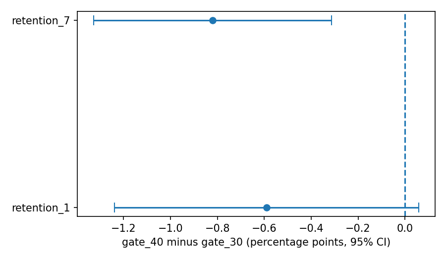

# A/B test analysis: Cookie Cats gate placement

Does moving the first gate in the mobile game Cookie Cats from level 30 to level 40 change player retention? This project tests that with a two-group experiment of 90,189 players, using Python, statsmodels and SciPy.

**Result in one line:** 7-day retention fell by 0.82 points when the gate moved to level 40 (19.02% to 18.20%; 95% CI -1.33 to -0.31; p = 0.0016), so the recommendation is to keep the gate at level 30.

## Question and hypotheses
- **Primary metric:** 7-day retention (did the player come back 7 days after installing?).
- **Secondary metric:** 1-day retention.
- **Null hypothesis:** retention is the same in both groups. **Alternative:** it differs.
- **Significance level:** 0.05 for the primary metric, and a stricter 0.025 when both metrics are tested.

## Data
The Cookie Cats A/B test dataset, available on Kaggle: 90,189 players and five columns (`userid`, `version`, `sum_gamerounds`, `retention_1`, `retention_7`). Players were assigned either `gate_30` or `gate_40`.

The data file is **not included** in this repository. To run the notebook, download it from Kaggle and place it in a `data/` folder as `cookie_cats.txt` (or change the file name in the first code cell).

## Method
1. Checked data quality: no missing values and no duplicate user IDs.
2. Checked that players were split evenly between the groups (chi-square test).
3. Compared retention between the groups with a two-proportion z-test and 95% confidence intervals.
4. Used a stricter 0.025 cut-off because two metrics were tested.
5. Robustness checks: removed the 91 most active players (above the 99.9th percentile of game rounds) and ran a simulation cross-check.
6. Power check: the smallest difference the test could reliably detect.
7. Exploratory only: game rounds by group.

## Results

| Metric | gate_30 | gate_40 | Difference (points) | 95% CI (points) | p-value |
|---|---|---|---|---|---|
| 1-day retention | 44.82% | 44.23% | -0.59 | -1.24 to +0.06 | 0.0744 |
| 7-day retention | 19.02% | 18.20% | -0.82 | -1.33 to -0.31 | 0.0016 |



- **7-day retention** fell when the gate moved to level 40, and the result holds with the extreme players removed (-0.83 points, p = 0.0013). A simulation cross-check gives the same 95% range (-1.33 to -0.31).
- **1-day retention** fell by 0.59 points but does not pass the stricter 0.025 cut-off (p = 0.0744).
- **Size of the test:** with about 44,700 players per group, the smallest difference the test could reliably detect is about 0.74 points. The observed 7-day drop (0.82) is only just above that, so I am confident about the direction of the effect but less sure about its exact size.
- **Game rounds (exploratory):** medians of 17 and 16 rounds, Mann-Whitney p = 0.0502. Not a planned metric, so no conclusion is drawn.

## Recommendation
**Keep the gate at level 30.** Moving it to level 40 lowered 7-day retention, and the result is robust to the checks above.

## Limitations
- **Uneven split:** 44,700 vs 45,489 players (p = 0.0086). This is below 0.01 but above the stricter 0.001 level many teams use as an alarm. It could point to an assignment or logging issue, which cannot be checked with this dataset, so it is reported as a caution.
- One game, one change, one period, and no revenue data. A retention gain is not proven to be a revenue gain, and the data cannot say why players left.
- Retention is measured at day 1 and day 7 only, so longer-term effects are unknown.
- Game rounds are recorded after the gate, so they are only exploratory.
- Two metrics were tested with a stricter cut-off, but no other multiple-testing correction was applied.

## How to run
1. Install the packages: `pip install -r requirements.txt`
2. Download the dataset from Kaggle and put it in a `data/` folder.
3. Open `ab_test_analysis.ipynb` in Jupyter and run all cells.

## Repository structure
```
ab-test-analysis/
├── README.md
├── ab_test_analysis.ipynb      the full analysis, with notes under every result
├── requirements.txt
├── .gitignore
└── outputs/                    charts saved by the notebook
```

## Author
Harshvardhan Singh: [GitHub](https://github.com/CryptedBlade) · [LinkedIn](https://www.linkedin.com/in/harshhhhhh) · [Portfolio](https://harshhhhhdata.lovable.app)
